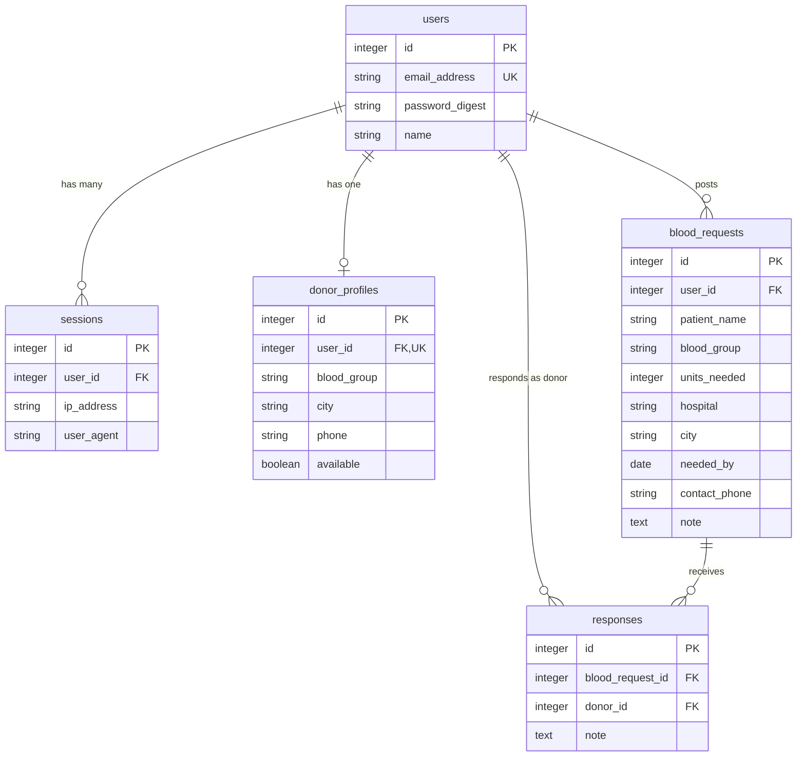

# Blood Donor Connect — database schema

Five tables. `users` and `sessions` come from the Rails 8 authentication generator; `donor_profiles`, `blood_requests` and `responses` are created live by a mentor in the first 20 minutes of the build.

After that, `db/schema.rb` is the source of truth. If this file and `db/schema.rb` disagree, `db/schema.rb` is right and this file needs updating.

See also: [PRD.md](PRD.md), [ATTENDEE_TASKS.md](ATTENDEE_TASKS.md), [TASKS.md](TASKS.md), [MVC_GUIDE.md](MVC_GUIDE.md), [UI_DESIGN.md](UI_DESIGN.md).

## Diagram



Every table also has `created_at` and `updated_at`.

## Tables

### users

Created by the authentication generator. `name` is added by a mentor.

| Column | Type | Null | Default | Notes |
| --- | --- | --- | --- | --- |
| id | integer | no | | primary key |
| email_address | string | no | | unique index |
| password_digest | string | no | | set by `has_secure_password` |
| name | string | yes | | required by a model validation, not by the database |

### sessions

Created by the authentication generator. Nobody edits this table.

| Column | Type | Null | Default | Notes |
| --- | --- | --- | --- | --- |
| id | integer | no | | primary key |
| user_id | integer | no | | foreign key to `users` |
| ip_address | string | yes | | |
| user_agent | string | yes | | |

### donor_profiles (Modules A and B)

| Column | Type | Null | Default | Notes |
| --- | --- | --- | --- | --- |
| id | integer | no | | primary key |
| user_id | integer | no | | foreign key to `users`; unique index, so one profile per user |
| blood_group | string | no | | one of `BLOOD_GROUPS` |
| city | string | no | | one of `CITIES` |
| phone | string | no | | never shown on list pages |
| available | boolean | no | true | |

Index: `(blood_group, city)` for the donors list filters.

### blood_requests (Modules C and D)

| Column | Type | Null | Default | Notes |
| --- | --- | --- | --- | --- |
| id | integer | no | | primary key |
| user_id | integer | no | | foreign key to `users`; the requester |
| patient_name | string | no | | |
| blood_group | string | no | | one of `BLOOD_GROUPS` |
| units_needed | integer | no | 1 | at least 1 |
| hospital | string | no | | |
| city | string | no | | one of `CITIES` |
| needed_by | date | no | | |
| contact_phone | string | no | | |
| note | text | yes | | |

Index: `(blood_group, city)` for the requests list filters.

### responses (Module E)

| Column | Type | Null | Default | Notes |
| --- | --- | --- | --- | --- |
| id | integer | no | | primary key |
| blood_request_id | integer | no | | foreign key to `blood_requests` |
| donor_id | integer | no | | foreign key to `users`, not to `donor_profiles` |
| note | text | yes | | |

Index: unique on `(blood_request_id, donor_id)`, so a donor can respond to a request only once.

## Allowed values

```ruby
BLOOD_GROUPS = %w[A+ A- B+ B- AB+ AB- O+ O-].freeze
CITIES = %w[Pune Mumbai Nashik Nagpur Kolhapur].freeze
```

Both are stored as plain strings. The database does not check them; the model validations do.

## Commands for the mentor (0:00 - 0:20)

```bash
bin/rails generate migration AddNameToUsers name:string
bin/rails generate model DonorProfile user:references blood_group:string city:string phone:string available:boolean
bin/rails generate model BloodRequest user:references patient_name:string blood_group:string units_needed:integer hospital:string city:string needed_by:date contact_phone:string note:text
bin/rails generate model Response blood_request:references donor:references note:text
```

Edit the three `create_*` migrations before running `bin/rails db:migrate`. The generators do not add these on their own:

```ruby
# create_donor_profiles
t.references :user, null: false, foreign_key: true, index: { unique: true }
t.string  :blood_group, null: false
t.string  :city,        null: false
t.string  :phone,       null: false
t.boolean :available,   null: false, default: true
# after the create_table block
add_index :donor_profiles, [:blood_group, :city]

# create_blood_requests
t.string  :patient_name,  null: false
t.string  :blood_group,   null: false
t.integer :units_needed,  null: false, default: 1
t.string  :hospital,      null: false
t.string  :city,          null: false
t.date    :needed_by,     null: false
t.string  :contact_phone, null: false
# after the create_table block
add_index :blood_requests, [:blood_group, :city]

# create_responses
t.references :donor, null: false, foreign_key: { to_table: :users }
# after the create_table block
add_index :responses, [:blood_request_id, :donor_id], unique: true
```

The `donor` line is the one that breaks if left as generated: `foreign_key: true` points at a `donors` table that does not exist.

## Associations

Attendees write these in their own model files. They are listed here so everyone uses the same names.

```ruby
class User < ApplicationRecord
  has_one  :donor_profile, dependent: :destroy
  has_many :blood_requests, dependent: :destroy
  has_many :responses, foreign_key: :donor_id, dependent: :destroy
end

class DonorProfile < ApplicationRecord
  belongs_to :user
end

class BloodRequest < ApplicationRecord
  belongs_to :user
  has_many :responses, dependent: :destroy
end

class Response < ApplicationRecord
  belongs_to :blood_request
  belongs_to :donor, class_name: "User"
end
```

The `User` lines are added by a mentor, since no attendee owns `app/models/user.rb`.
