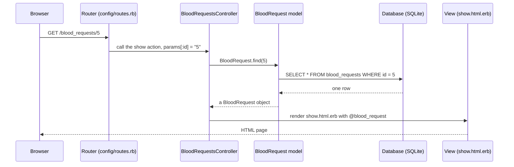

# Blood Donor Connect — understanding MVC

A beginner's guide to how a Rails app is organised, using the app we are building today. Read it before you start your module, and come back to it whenever you are unsure where a piece of code belongs.

See also: [PRD.md](PRD.md) for what we are building, [DB_SCHEMA.md](DB_SCHEMA.md) for the tables, and [ATTENDEE_TASKS.md](ATTENDEE_TASKS.md) for your module.

## MVC in one minute

Rails splits every feature into three kinds of code, each in its own folder, each with one job.

| Part | Folder | Its job | One-line question it answers |
| --- | --- | --- | --- |
| **M**odel | `app/models/` | Talks to the database and holds the rules about data | "What is a valid blood request, and how do I find one?" |
| **V**iew | `app/views/` | Builds the HTML page the user sees | "What does the request page look like?" |
| **C**ontroller | `app/controllers/` | Receives the browser's request, asks the model for data, picks a view | "Someone opened `/blood_requests/5`. What do I do?" |

There is a fourth piece that sits in front of all of them:

| Part | File | Its job |
| --- | --- | --- |
| **Routes** | `config/routes.rb` | Maps a URL to a controller action, like a receptionist pointing you to the right desk |

### An analogy: the hospital blood bank

Imagine walking into a hospital blood bank to ask for O+ blood.

- The **receptionist** looks at what you want and sends you to the right counter. That is the **router**.
- The **counter clerk** takes your form, checks you are allowed to ask, fetches records from the back room and hands you a printed slip. That is the **controller**.
- The **records room** stores every donor and request, and refuses to file a form with missing details. That is the **model** (plus the database behind it).
- The **printed slip** you walk away with is the **view**.

The clerk never redesigns the slip, and the records room never talks to you directly. Each part does its own job. That separation is the whole point of MVC.

## What happens when you open a page

Say a donor clicks a request in the list and the browser goes to `/blood_requests/5`.



The same six steps happen for every page in the app. Once you can trace this one, you can trace them all.

1. **Browser** sends a request: a verb (`GET`, `POST`, ...) and a path (`/blood_requests/5`).
2. **Router** matches it to a controller and an action (`blood_requests#show`).
3. **Controller action** runs. It reads anything from the URL or form out of `params`.
4. **Model** fetches or saves data. You write Ruby; Rails writes the SQL for you.
5. **Controller** stores the result in an instance variable (a name starting with `@`), which the view can see.
6. **View** turns that data into HTML and sends it back.

## Where things live in this repo

```
app/
├── models/          M — one file per table: donor_profile.rb, blood_request.rb, response.rb, user.rb
├── controllers/     C — one file per resource: blood_requests_controller.rb, donors_controller.rb, ...
├── views/           V — one folder per controller, one file per page
│   ├── layouts/application.html.erb    the frame around every page (nav bar, <head>)
│   └── blood_requests/                 index, new, show, _form ...
config/
└── routes.rb        URL → controller#action (mentors set this up; nobody edits it today)
db/
├── migrate/         the scripts that created the tables (done by a mentor at 0:00)
├── schema.rb        the current shape of the database, generated, never hand-edited
└── seeds.rb         fake donors and requests for the demo
```

Rails relies on **naming conventions** to connect these files, so you rarely wire them up yourself:

| Thing | Name | Rails guesses |
| --- | --- | --- |
| Table | `blood_requests` (plural, snake_case) | |
| Model | `BloodRequest` in `app/models/blood_request.rb` (singular) | its table is `blood_requests` |
| Controller | `BloodRequestsController` in `app/controllers/blood_requests_controller.rb` (plural) | |
| Views | `app/views/blood_requests/show.html.erb` | the `show` action renders this file automatically |

If a name is off by one letter (`BloodRequest` vs `Bloodrequest`, `blood_request` vs `blood_requests`), Rails cannot find the file. Most "uninitialized constant" and "missing template" errors are a naming typo.

## The Model

A model is a Ruby class that represents one table. Each **object** of the class is one **row**.

```ruby
# app/models/blood_request.rb
class BloodRequest < ApplicationRecord
  belongs_to :user                      # every request has an owner
  has_many :responses, dependent: :destroy

  validates :patient_name, :hospital, :contact_phone, :needed_by, presence: true
  validates :blood_group, inclusion: { in: BLOOD_GROUPS }
  validates :city, inclusion: { in: CITIES }
  validates :units_needed, numericality: { only_integer: true, greater_than_or_equal_to: 1 }
end
```

What belongs in a model:

- **Associations**: how tables relate (`belongs_to`, `has_many`, `has_one`). These give you methods like `request.user` and `user.blood_requests` for free.
- **Validations**: rules a row must pass before it is saved. If a rule fails, `save` returns `false` and `errors` says why.
- **Queries you reuse**: for example "requests of this blood group, newest first".

What does **not** belong in a model: anything about HTML, buttons, URLs or who is logged in.

### Try it in the console

The Rails console lets you talk to your models without a browser. It is the fastest way to check your model works.

```bash
bin/rails console
```

```ruby
BloodRequest.count                        # how many rows?
BloodRequest.last                         # the newest row as an object
BloodRequest.where(blood_group: "O+")     # all O+ requests

r = BloodRequest.new(blood_group: "O+")   # build one in memory, not saved yet
r.valid?                                  # => false
r.errors.full_messages                    # => ["Patient name can't be blank", ...]

User.first.blood_requests                 # all requests by the first user (from has_many)
BloodRequest.first.user.name              # the owner's name (from belongs_to)
```

If your validations work in the console, they will work in the form. Test here first.

## The Controller

A controller is a Ruby class with one method per **action**. Each action handles one kind of request. Rails uses seven standard action names:

| Action | URL and verb | What it does | Renders |
| --- | --- | --- | --- |
| `index` | `GET /blood_requests` | list many | `index.html.erb` |
| `show` | `GET /blood_requests/5` | show one | `show.html.erb` |
| `new` | `GET /blood_requests/new` | show an empty form | `new.html.erb` |
| `create` | `POST /blood_requests` | save the submitted form | redirects to `show`, or re-shows the form on error |
| `edit` | `GET /blood_requests/5/edit` | show a filled form | `edit.html.erb` |
| `update` | `PATCH /blood_requests/5` | save changes | redirects, or re-shows the form |
| `destroy` | `DELETE /blood_requests/5` | delete | redirects |

Today we mostly use `index`, `show`, `new` and `create`.

```ruby
# app/controllers/blood_requests_controller.rb
class BloodRequestsController < ApplicationController
  # Module D
  def index
    @blood_requests = BloodRequest.order(created_at: :desc)
    @blood_requests = @blood_requests.where(blood_group: params[:blood_group]) if params[:blood_group].present?
  end

  # Module C
  def show
    @blood_request = BloodRequest.find(params[:id])
  end

  def new
    @blood_request = BloodRequest.new
  end

  def create
    @blood_request = Current.user.blood_requests.new(blood_request_params)

    if @blood_request.save
      redirect_to @blood_request, notice: "Request posted."
    else
      render :new, status: :unprocessable_entity
    end
  end

  private

  def blood_request_params
    params.expect(blood_request: [ :patient_name, :blood_group, :units_needed, :hospital,
                                   :city, :needed_by, :contact_phone, :note ])
  end
end
```

Things to notice:

- **`params`** holds everything the browser sent: the `5` from `/blood_requests/5` (as `params[:id]`), the filter from `?blood_group=O+`, and the form fields.
- **`@blood_request`** (with `@`) is visible in the view. A plain `blood_request` (no `@`) is not.
- **`Current.user`** is the logged-in user. It comes from the login system the mentors set up. Building the request through `Current.user.blood_requests.new` sets `user_id` for you, so nobody can post a request as someone else.
- **`blood_request_params`** is called *strong parameters*. It lists exactly which form fields are allowed through. Without it, a sneaky user could add `user_id=1` to the form and pretend to be another user.
- **`create` never renders a "success" page.** It redirects to `show`. That way refreshing the page does not submit the form twice.
- **Every page needs login** by default, because `ApplicationController` includes the authentication code. You do not need to add anything.

What belongs in a controller: reading `params`, calling the model, deciding where to go next. What does **not**: long queries (move them to the model), HTML (move it to the view), validation rules (model).

## The View

A view is an HTML file with bits of Ruby mixed in. The `.html.erb` extension means "HTML with Embedded RuBy".

There are two ERB tags, and mixing them up is the most common beginner bug:

| Tag | Meaning | Example |
| --- | --- | --- |
| `<%= ... %>` | run the Ruby **and print** the result into the page | `<%= @blood_request.hospital %>` |
| `<% ... %>` | run the Ruby but **print nothing** (used for `if` and loops) | `<% if @blood_request.note.present? %>` |

```erb
<%# app/views/blood_requests/show.html.erb %>
<h1><%= @blood_request.blood_group %> needed at <%= @blood_request.hospital %></h1>

<p>Patient: <%= @blood_request.patient_name %></p>
<p>Units: <%= @blood_request.units_needed %></p>
<p>City: <%= @blood_request.city %></p>
<p>Needed by: <%= @blood_request.needed_by %></p>

<% if @blood_request.note.present? %>
  <p>Note: <%= @blood_request.note %></p>
<% end %>

<%# Module D and E add their partials below this line %>
```

And a list page loops over a collection:

```erb
<%# app/views/blood_requests/index.html.erb %>
<h1>Open requests</h1>

<% @blood_requests.each do |request| %>
  <p>
    <%= link_to "#{request.blood_group} · #{request.units_needed} units · #{request.hospital}, #{request.city}",
                request %>
  </p>
<% end %>
```

### Forms

`form_with` builds a form tied to a model. Rails picks the right URL and verb (`POST /blood_requests` for a new object) by itself.

```erb
<%# app/views/blood_requests/_form.html.erb %>
<%= form_with model: @blood_request do |f| %>
  <% @blood_request.errors.full_messages.each do |message| %>
    <p class="error"><%= message %></p>
  <% end %>

  <%= f.label :blood_group %>
  <%= f.select :blood_group, BLOOD_GROUPS, include_blank: "Choose…" %>

  <%= f.label :units_needed %>
  <%= f.number_field :units_needed, min: 1 %>

  <%# ...the other fields... %>

  <%= f.submit "Post request" %>
<% end %>
```

### Partials

A file whose name starts with `_` is a **partial**: a reusable piece of a page. `_form.html.erb` can be shared by `new` and `edit`. Modules D and E build their sections as partials so they can drop them into Module C's request page without editing the same lines:

```erb
<%= render "blood_requests/matching_donors", blood_request: @blood_request %>
<%= render "responses/list", blood_request: @blood_request %>
```

### The layout

`app/views/layouts/application.html.erb` wraps every page. The `<%= yield %>` inside it is where your view's HTML is inserted. The nav bar lives there, so you do not repeat it on every page.

What belongs in a view: displaying data, links, forms, simple `if`s about what to show. What does **not**: database queries (`BloodRequest.where(...)` in a view is a smell; the controller should prepare the data) or rules about data (model).

## Routes

Routes connect URLs to controller actions. The mentors have already written them, so you will not edit `config/routes.rb` today, but you should be able to read them.

```ruby
# config/routes.rb
resources :blood_requests, only: [ :index, :show, :new, :create ]
```

That one line creates four routes. To see every route in the app:

```bash
bin/rails routes
```

```
         Prefix Verb URI Pattern                   Controller#Action
 blood_requests GET  /blood_requests               blood_requests#index
                POST /blood_requests               blood_requests#create
new_blood_request GET /blood_requests/new          blood_requests#new
  blood_request GET  /blood_requests/:id           blood_requests#show
```

The **Prefix** column gives you helper methods for links: `blood_requests_path` is `/blood_requests`, `new_blood_request_path` is `/blood_requests/new`, and `blood_request_path(@blood_request)` is `/blood_requests/5`. Use these helpers in views instead of typing URLs.

## A full journey: posting a blood request

Here is Module C end to end, showing which part of MVC handles each step.

| Step | What the user does | URL | Who handles it |
| --- | --- | --- | --- |
| 1 | Clicks "Request blood" in the nav | `GET /blood_requests/new` | Router → `new` action builds an empty `BloodRequest` → `new.html.erb` shows the form |
| 2 | Fills the form, clicks "Post request" | `POST /blood_requests` | Router → `create` action takes `blood_request_params`, attaches `Current.user` |
| 3a | Left "units" blank | | Model validation fails → `save` returns `false` → controller re-renders `new` → view shows the error |
| 3b | Filled everything correctly | | Model saves the row → controller redirects to `/blood_requests/7` |
| 4 | Browser follows the redirect | `GET /blood_requests/7` | Router → `show` action finds request 7 → `show.html.erb` displays it |

Notice that the **form never talks to the database directly**, and **the model never decides which page to show**. Each part stays in its lane.

## Your module, in MVC terms

| Module | Model (M) | Controller (C) | View (V) |
| --- | --- | --- | --- |
| A. Donor profile | `DonorProfile` validations | `DonorProfilesController` `new`, `create`, `edit`, `update` | `donor_profiles/new`, `edit`, `_form` |
| B. Donor directory | uses `DonorProfile` (read only) | `DonorsController#index` with filters from `params` | `donors/index` |
| C. Blood requests | `BloodRequest` associations and validations | `BloodRequestsController` `new`, `create`, `show` | `blood_requests/new`, `_form`, `show` |
| D. Requests list | uses `BloodRequest` (read only) | `BloodRequestsController#index` with a filter | `blood_requests/index`, `_matching_donors` |
| E. Responses | `Response` associations and uniqueness | `ResponsesController#create` | `responses/_button`, `_list` |

Modules B and D do not write any model code. A filter is a controller reading `params[:blood_group]` and asking the model for matching rows:

```ruby
# Module B: app/controllers/donors_controller.rb
def index
  @donors = DonorProfile.includes(:user)
  @donors = @donors.where(blood_group: params[:blood_group]) if params[:blood_group].present?
end
```

The filter dropdown in the view is a small `GET` form, so the choice ends up in the URL as `/donors?blood_group=O%2B`:

```erb
<%= form_with url: donors_path, method: :get do |f| %>
  <%= f.select :blood_group, BLOOD_GROUPS, include_blank: "All groups", selected: params[:blood_group] %>
  <%= f.submit "Filter" %>
<% end %>
```

## Where does this code go? (self-check)

Cover the right-hand column and try each one.

| I want to... | Goes in |
| --- | --- |
| Make phone required on a donor profile | Model: `validates :phone, presence: true` |
| Show a donor's city on the list page | View: `<%= donor.city %>` |
| Only show requests for the blood group the user picked | Controller: read `params[:blood_group]`, call `.where` on the model |
| Stop a donor from responding twice | Model: `validates :donor_id, uniqueness: { scope: :blood_request_id }` (the database index is a second safety net) |
| Send the user to the request page after saving | Controller: `redirect_to @blood_request` |
| Hide the responses list from everyone except the request's creator | View decides what to show (`<% if @blood_request.user == Current.user %>`); a mentor helps with this in Module E |
| Add a new URL | Routes, and today that means asking a mentor |
| Add a new column | A migration, and today that means asking a mentor |

## Common errors and what they mean

| Error | Usually means | Look in |
| --- | --- | --- |
| `No route matches [GET] "/blood_request"` | URL typo, or the route does not exist | `bin/rails routes` |
| `The action 'show' could not be found` | Route exists, but the controller has no method with that name | Controller |
| `missing a template for this request` | Action exists, but no view file with the matching name | `app/views/<controller>/` |
| `undefined method 'hospital' for nil` | The `@variable` is empty: not set in the controller, or a typo in its name | Controller action |
| `uninitialized constant BloodRequest` | File name or class name does not match the convention | `app/models/` |
| `ActiveRecord::RecordNotFound` | `find` was given an id that does not exist | The URL, or your seed data |
| Form saves but a field is empty | Field missing from the strong parameters list | `*_params` method in the controller |
| Value shows in the page as nothing | Used `<% %>` instead of `<%= %>` | View |

When you see an error page in the browser, read the first line and the highlighted file and line number. They nearly always point straight at the problem.

## Explaining your module at the demo

Your explain task (A4, B4, C4, D4, E4) is easiest if you follow the request through MVC. Fill this in for your own screen:

1. "When you open **[URL]**, the router sends it to **[Controller#action]**."
2. "The action asks the model for **[data]** using **[the query]**."
3. "The model makes sure **[your validations or rules]**."
4. "The view **[file name]** shows **[what]**, and does not show **[phone numbers / other private data]**."
5. "If something is wrong, like **[a missing field / a duplicate response]**, **[what happens]**."

Example for Module C: "When you open `/blood_requests/new`, the router sends it to `BloodRequestsController#new`, which gives the form an empty request. Submitting goes to `create`, which builds the request for the logged-in user. The model checks every field except note is filled and units is at least 1. If that passes, you are redirected to `show`, which displays the request. If not, the form comes back with the errors."

## Using AI tools with MVC

Asking your AI tool in MVC terms gets you much better code:

- Name the layer: "In the **model** `app/models/response.rb`, add a validation so..." rather than "make it so you can't respond twice".
- One layer at a time: model first, test it in the console, then controller, then view.
- After it answers, ask: "Which part of this is model, controller and view, and why is each piece there?" If code is in the wrong layer (a query inside a view, HTML inside a model), ask it to move it.

## Glossary

| Word | Meaning |
| --- | --- |
| Action | A method in a controller that handles one URL, like `show` or `create` |
| Active Record | The part of Rails that maps model classes to database tables |
| Association | A link between models: `belongs_to`, `has_many`, `has_one` |
| ERB | Embedded Ruby: the `<% %>` and `<%= %>` tags in views |
| Instance variable | A variable starting with `@`; set in the controller, read in the view |
| Migration | A Ruby script that changes the database structure |
| `params` | A hash of everything the browser sent: URL parts, query string, form fields |
| Partial | A reusable view file whose name starts with `_` |
| Redirect | Telling the browser "go to this other URL now" |
| Render | Building a view into HTML and sending it back |
| Resource | A thing the app manages through standard actions, like blood requests |
| Route | A rule mapping a verb and URL to a controller action |
| Strong parameters | The list of form fields a controller allows into the model |
| Validation | A rule a model checks before saving a row |
